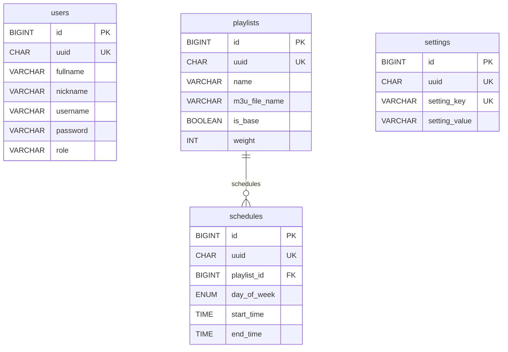

# Estrutura do banco de dados

Este arquivo representa o estado atual do banco de dados do Streamora. Ele deve
ser atualizado sempre que uma migration criar, alterar ou remover tabelas,
colunas, chaves ou relacionamentos.

As migrations em `src/main/resources/db/migration` continuam sendo a fonte
executável e o histórico de alterações do banco. Este diagrama serve como uma
visão consolidada da estrutura resultante.

## Restrições e tipos

- Todas as chaves primárias `id` são `BIGINT UNSIGNED` e auto incrementais.
- Todos os campos `uuid` são `CHAR(36)`, obrigatórios e únicos.
- Os campos textuais obrigatórios são `VARCHAR(255)`.
- `playlists.m3u_file_name` é um `VARCHAR(255)` opcional e armazena somente o
  nome do arquivo M3U, sem caminho de diretório.
- `playlists.is_base` é obrigatório, aceita várias playlists base e usa
  `FALSE` como valor padrão.
- `playlists.weight` é um inteiro positivo obrigatório, usa `1` como valor
  padrão e representa a proporção da playlist em uma combinação.
- `schedules.day_of_week` aceita os valores `MONDAY`, `TUESDAY`,
  `WEDNESDAY`, `THURSDAY`, `FRIDAY`, `SATURDAY` ou `SUNDAY`.
- `schedules.start_time` e `schedules.end_time` armazenam o
  intervalo de execução da playlist.
- A chave estrangeira `schedules.playlist_id` referencia
  `playlists.id` e usa `ON DELETE CASCADE` e `ON UPDATE CASCADE`.
