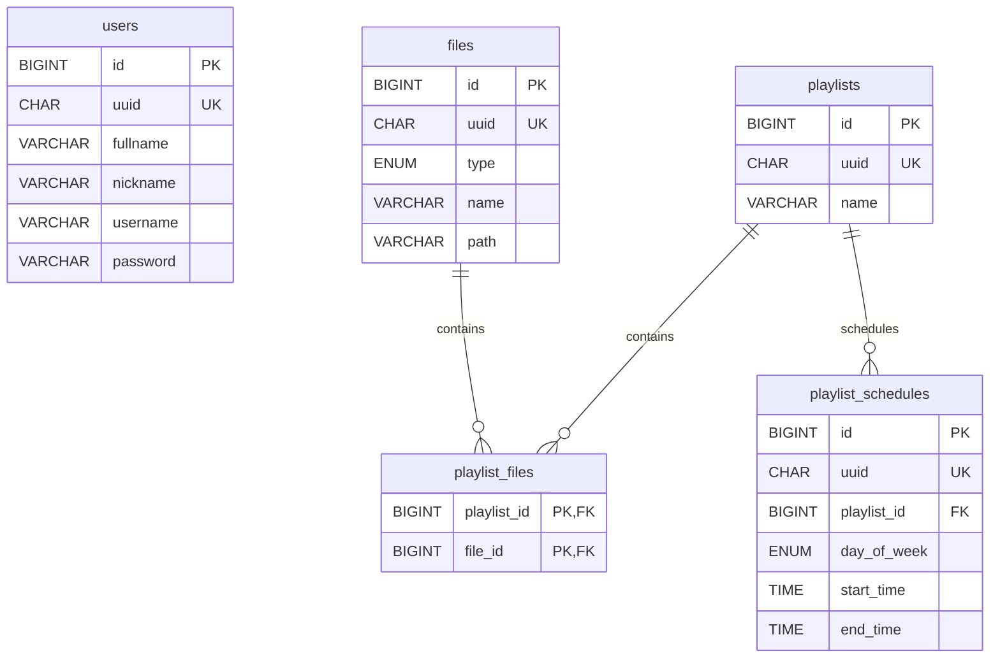

# Estrutura do banco de dados

Este arquivo representa o estado atual do banco de dados do Streamora. Ele deve
ser atualizado sempre que uma migration criar, alterar ou remover tabelas,
colunas, chaves ou relacionamentos.

As migrations em `src/main/resources/db/migration` continuam sendo a fonte
executável e o histórico de alterações do banco. Este diagrama serve como uma
visão consolidada da estrutura resultante.

## Restrições e tipos

- Todas as chaves primárias `id` são `BIGINT UNSIGNED` e auto incrementais.
- Todos os campos `uuid` são `CHAR(36)`, obrigatórios e únicos.
- Os campos textuais são `VARCHAR(255)` e obrigatórios.
- `files.type` aceita `music`, `station_id`, `sweeper`, `jingle`, `commercial`
  ou `bumper`.
- `playlist_files` possui chave primária composta por `playlist_id` e `file_id`.
- As duas chaves estrangeiras de `playlist_files` usam `ON DELETE CASCADE` e
  `ON UPDATE CASCADE`.
- `playlist_schedules.day_of_week` aceita os valores `MONDAY`, `TUESDAY`,
  `WEDNESDAY`, `THURSDAY`, `FRIDAY`, `SATURDAY` ou `SUNDAY`.
- `playlist_schedules.start_time` e `playlist_schedules.end_time` armazenam o
  intervalo de execução da playlist.
- A chave estrangeira `playlist_schedules.playlist_id` referencia
  `playlists.id` e usa `ON DELETE CASCADE` e `ON UPDATE CASCADE`.
